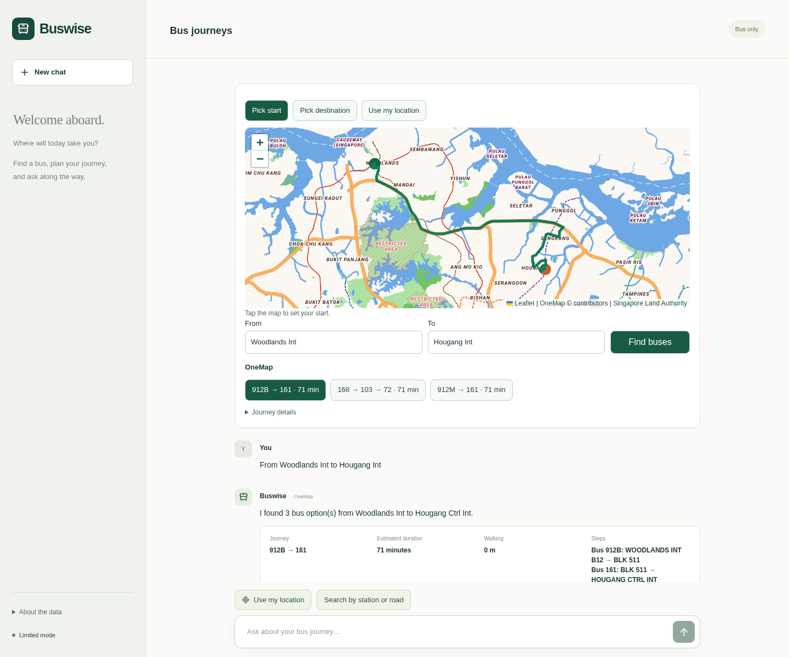
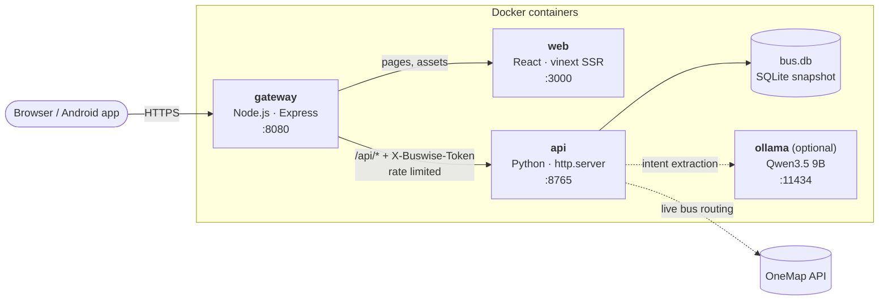

# Buswise

[](https://github.com/abuhasif/BusWise-AI-Chatbot/actions/workflows/ci.yml)

Buswise is a conversational assistant for Singapore bus journeys. It combines Qwen3.5 9B for query understanding, OneMap for bus-only route planning and a bundled January 2026 SQLite snapshot for stop and timetable lookups.



## What it does

- Plans bus-only journeys with walking access and transfers through OneMap
- Answers direct-route, stop-service and first/last-bus questions from the local snapshot
- Keeps route context for follow-ups such as “what about Sunday?” and “where do I change?”
- Shows routes, stops and location-selected start points on an interactive map

## Architecture



| Service | Tech | Role |
| --- | --- | --- |
| `gateway` | Node.js 22, Express 5 | The only public entry point. Proxies `/api/*` to the Python API and adds the shared `X-Buswise-Token`, replacing any token a client sends. Applies a per-IP rate limit to `/api`, tags every request with an `x-request-id`, writes JSON access logs, and serves `/healthz` (liveness) and `/readyz` (checks both upstreams). Everything else goes to `web`. |
| `web` | React 19, vinext (Next.js App Router on Vite) | Chat UI and Leaflet map. Built for Cloudflare Workers by default, or as a Node server for Docker (`BUSWISE_TARGET=node`). |
| `api` | Python 3.12, standard library only | Intent parsing, route search and timetable answers. Accepts loopback callers, and any other caller only with the shared token. |
| `ollama` | Ollama + Qwen3.5 9B (optional) | Natural-language intent extraction. Without it, the API answers in **limited mode** using deterministic rules. |

CI ([`.github/workflows/ci.yml`](.github/workflows/ci.yml)) runs on every push and pull request:

1. **Frontend:** oxlint, TypeScript, React Testing Library tests, Node unit tests and a production build
2. **Gateway:** proxy, token, rate-limit and health tests
3. **Backend:** Python unit tests
4. **Docker:** builds all three images, starts the stack with Docker Compose, smoke-tests a chat request through the gateway, and checks that the API rejects callers without the token

## Run with Docker (quickest)

Requires [Docker Desktop](https://www.docker.com/products/docker-desktop/).

```bash
git clone https://github.com/abuhasif/BusWise-AI-Chatbot.git
cd BusWise-AI-Chatbot
cp .env.example .env
# Set BUSWISE_API_TOKEN in .env to a random secret, e.g. the output of: openssl rand -hex 32
docker compose up --build
```

Open http://localhost:8080 (the port is bound to localhost only). This runs in limited mode (no language model). To add the local model as well (a download of several GB, and needs roughly 8 GB of free RAM):

```bash
docker compose --profile llm up --build -d
docker compose exec ollama ollama pull qwen3.5:9b
```

Settings live in `.env`, which is git-ignored. `BUSWISE_API_TOKEN` is required: it's the shared gateway-to-API secret and must be at least 32 characters. `ONEMAP_EMAIL` and `ONEMAP_PASSWORD` enable live OneMap routing, with automatic token renewal. See [`.env.example`](.env.example) for the optional gateway settings.

## Security

- **One public entry point:** only the gateway is reachable. The API and web containers have no published ports.
- **Service authentication:** the gateway adds a shared token (32+ characters, compared in constant time) to every API call. The API refuses non-local callers without it, and a token sent by a client is discarded.
- **Rate limits** (per IP, per minute): 300 requests overall, 60 to `/api`, and 20 to `/api/chat`. Forwarded IP headers are only trusted when `TRUST_PROXY` is set.
- **Security headers:**
  - A strict Content-Security-Policy with a fresh script nonce per response, no inline scripts and no framing.
  - HSTS, `nosniff`, a referrer policy and a Permissions-Policy.
  - Server version headers are removed.
- **CORS:** same-origin only. Browser calls from other sites get a 403, unless the site is listed in `ALLOWED_ORIGINS`.
- **Input:**
  - The gateway rejects non-JSON or oversized requests.
  - The API validates every field and length, and uses parameterised SQL.
  - The SQLite database is opened read-only.
  - React escapes all output, and map labels use `textContent`.
- **Containers:**
  - Run as non-root users, with a read-only filesystem, no Linux capabilities and `no-new-privileges`.
  - The app code is owned by root, so the app user can't modify it.
  - Images contain no tests, tokens or source maps.

## Deploy

See [`docs/deploy.md`](docs/deploy.md). It covers a **free** Google Cloud Run deployment (a one-click GitHub Actions workflow is included), Render's free tier, and AWS ECS Express Mode. AWS App Runner no longer accepts new customers.

## Run locally without Docker (Windows)

### Requirements

- Node.js 22.13+
- Python 3.11+
- [Ollama](https://ollama.com/)

### Setup

```powershell
git clone https://github.com/abuhasif/BusWise-AI-Chatbot.git
cd BusWise-AI-Chatbot
npm ci
python -m pip install -r backend/requirements.txt
ollama pull qwen3.5:9b
```

Optional: enable live OneMap route planning by setting `ONEMAP_EMAIL` and `ONEMAP_PASSWORD` (a free [OneMap account](https://www.onemap.gov.sg/apidocs/register)) in your environment. The API then renews OneMap's 3-day token automatically. A fixed `ONEMAP_TOKEN` or `data/onemap-token.txt` still works, but expires after 3 days. Never commit credentials.

```powershell
.\start-local.ps1
```

Open `http://127.0.0.1:3000`. Stop only services started by Buswise with:

```powershell
.\stop-local.ps1
```

The launcher uses the bundled runtime when it exists. On a fresh clone, it uses your installed `python` and `ollama` commands.

### Android development pairing

For the Android debug app, start the API with `.\start-local.ps1 -Mobile`. The launcher creates an ignored `data/mobile-api-token.txt` and requires that token for every non-loopback API request. Copy its value to the ignored Android `local.properties` file as `BUSWISE_MOBILE_TOKEN=...`; optionally set `BUSWISE_API_URL` there to a computer Wi-Fi address for a physical phone. Debug builds allow this local HTTP connection. Release builds have no API URL configured and require an HTTPS deployment before they can make network requests.

## Repository layout

```text
app/                React interface and interactive map
backend/            Python API, route logic, SQLite importer and Dockerfile
gateway/            Express gateway service, its tests and Dockerfile
data/bus.db         Public January 2026 route snapshot
docs/deploy.md      Hosting options and deployment steps
docs/evaluation/    Conversation test suites and reports
tests/react/        React Testing Library component tests (Vitest + jsdom)
tests/*.test.mjs    Node unit tests for frontend logic
Dockerfile.web      Web app image
docker-compose.yml  Full local stack
.github/workflows/  CI and Cloud Run deployment
```

The repository excludes OneMap credentials, downloaded models, logs and local process state.

## Data and limits

`data/bus.db` contains 5,194 stops, 421 services and 23,540 route-stop records from a January 2026 snapshot. First/last-bus times are scheduled values, not live arrivals. Current arrivals, disruption notices, fares and free-boarding status are unavailable.

OneMap results are limited to bus and walking legs. If OneMap is unavailable, Buswise labels its database fallback clearly; those dashed map lines connect recorded stops and are not road directions.

## Checks

```powershell
python -m unittest discover -s backend -p "test_*.py"   # backend
npm test                                                # React Testing Library
npm run test:node                                       # frontend logic
npm --prefix gateway ci; npm --prefix gateway test      # gateway
npm run lint
npm run build
```

See [`docs/evaluation/`](docs/evaluation/) for the conversational test cases and results.
